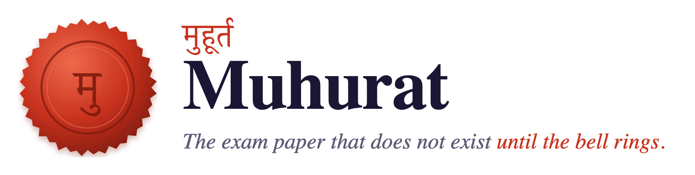
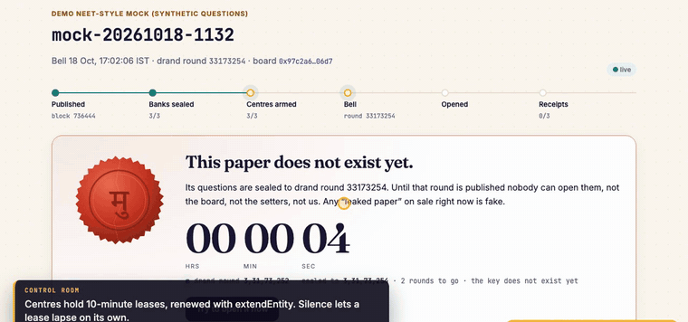
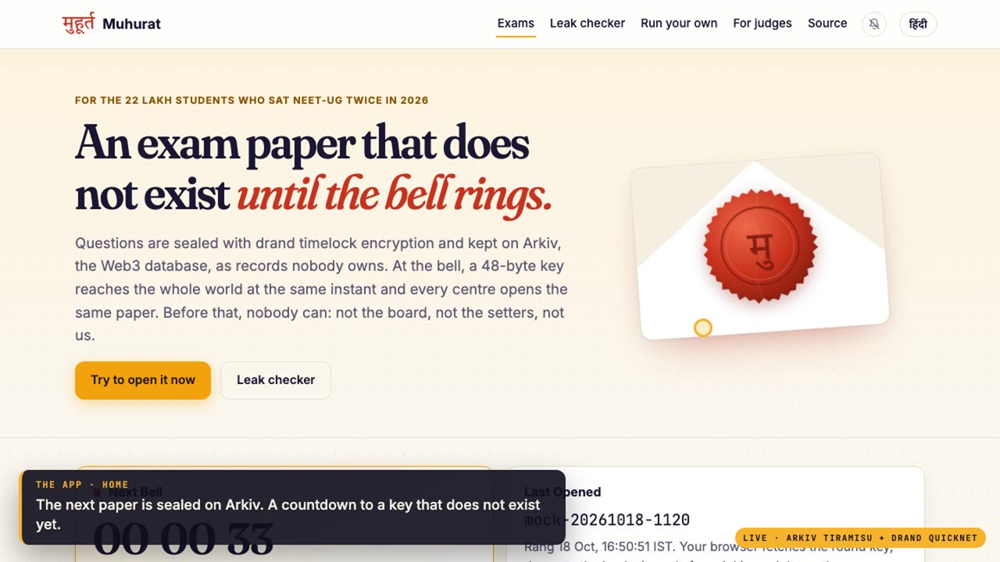
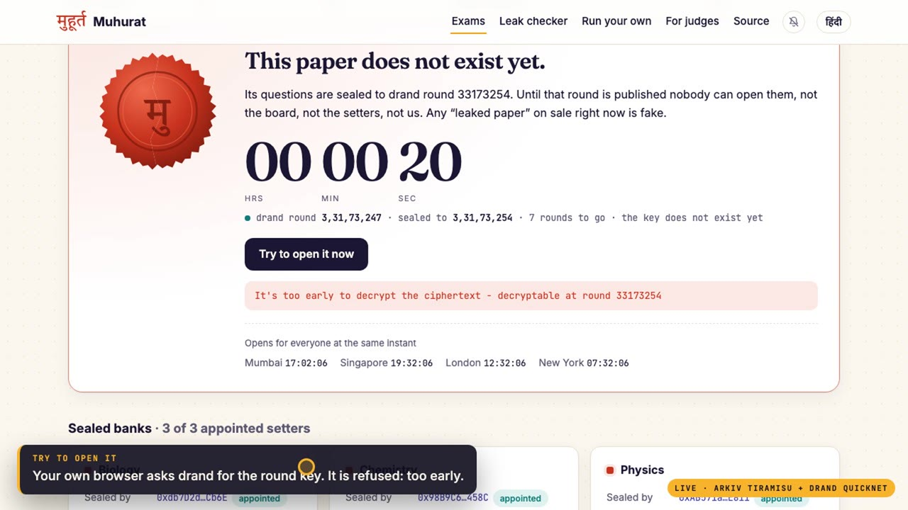
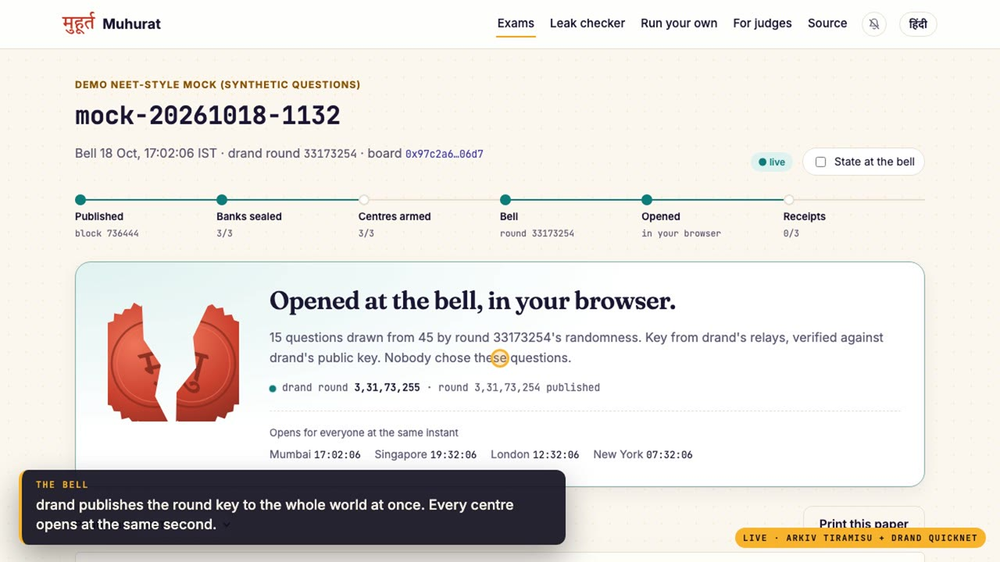
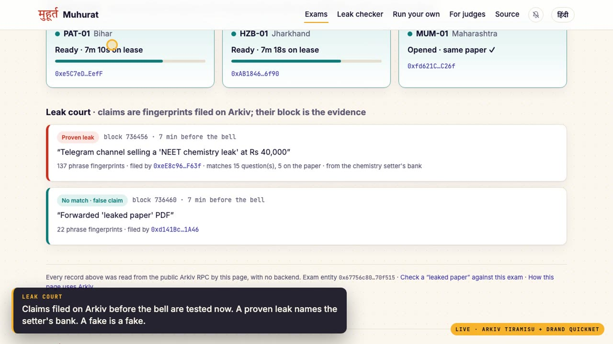
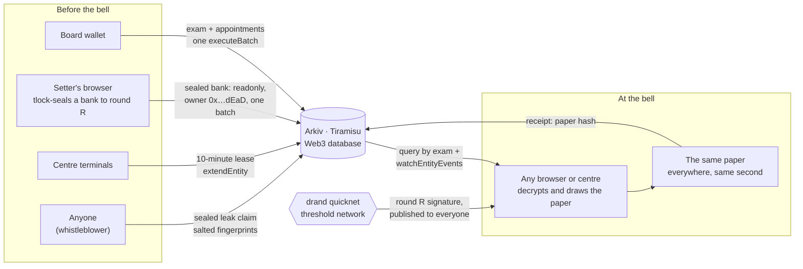
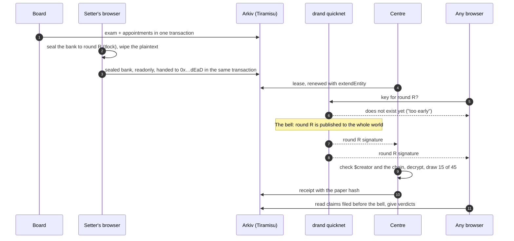

<p align="center">
  <picture>
    <source media="(prefers-color-scheme: dark)" srcset="docs/logo-dark.png">
    
  </picture>
</p>

<p align="center">
  <a href="https://github.com/TusharTechs/muhurat/actions/workflows/ci.yml"></a>
  <a href="https://github.com/TusharTechs/muhurat/actions/workflows/pages.yml"></a>
  <a href="LICENSE"></a>
  
  
  
</p>

<p align="center">
  <b><a href="https://tushartechs.github.io/muhurat/">Live app</a></b> ·
  <b><a href="#demo-video">Demo video</a></b> ·
  <b><a href="https://tushartechs.github.io/muhurat/#/proof">For judges</a></b> ·
  <a href="arkiv/schema.md">Data contract</a> ·
  <a href="arkiv/friction.md">Friction report</a> ·
  <a href="#run-it-locally">Run it locally</a>
</p>

Setters seal question banks in the browser with [drand](https://drand.love) timelock encryption. The sealed banks are published on [Arkiv](https://arkiv.network), the Web3 database, as readonly entities owned by `0x…dEaD`: publicly readable, impossible to edit, delete or open. At the bell, drand's threshold network publishes the round key to the whole world at once. Every centre opens the same paper, drawn from the banks by that round's public randomness. Before the bell nobody can read it: not the board, not the setters, not us. Nobody chose the final paper.

Built for **Arkiv: Global Tour Stop** (9 to 18 Oct 2026) on the road to Devcon 8 Mumbai. Tracks: **Best Indian Use Case** (primary), Security, Censorship Resistance, Privacy, Open Source.

<p align="center">
  
  <br><sub>Recorded live on Arkiv Tiramisu + drand quicknet: the countdown reaches the bell, the seal cracks, and the paper opens in the browser.</sub>
</p>

## For judges: every link in one place

| What | Link | What you'll find |
| --- | --- | --- |
| 🌐 **Live app** | [tushartechs.github.io/muhurat](https://tushartechs.github.io/muhurat/) | A sealed paper rings every two hours through 23 Oct. No wallet needed |
| 🎬 <a id="demo-video"></a>**Demo video** (2:57) | _YouTube link_ · [script and timeline](VIDEO.md) | The problem, the idea, and a live bell on Tiramisu |
| ✅ **For judges page** | [/#/proof](https://tushartechs.github.io/muhurat/#/proof) | Every Arkiv feature we use, with evidence computed live from the RPC, plus a link to the code |
| 🔎 **Leak checker** | [/#/check](https://tushartechs.github.io/muhurat/#/check) | Paste or screenshot a "leaked paper": fake before the bell, traced to a setter's bank after it |
| 🧪 **Run your own exam** | [/#/run](https://tushartechs.github.io/muhurat/#/run) | Be the board and the setters with MetaMask and faucet GLM, and watch your own bell |
| 📜 **Data contract** | [`arkiv/schema.md`](arkiv/schema.md) | Every entity type, attribute, Entity Expiration and trust rule, plus a raw `curl` read |
| 🧱 **Friction report** | [`arkiv/friction.md`](arkiv/friction.md) | Arkiv issues with repros and suggested fixes, including the query budget we hit live (F3), plus the paths that worked |
| ⛓️ **On-chain evidence** | [`schedule-evidence.jsonl`](arkiv/schedule-evidence.jsonl) · [`evidence-spike.json`](arkiv/evidence-spike.json) | Every exam we published: tx hashes, entity keys, rounds |
| 👛 **Board wallet** | [`0x97c2…06d7`](https://tiramisu.explorer.arkiv.network/address/0x97c2a64fEE201647BB667C1857Aee37aC06006d7) | Creates every exam and appointment. Spike wallet: [`0x518d…bA53`](https://tiramisu.explorer.arkiv.network/address/0x518dFCA1563A3C64a397509E8C3F71E3F014bA53) |
| 🧾 **Independent verifier** | [`scripts/verify.ts`](scripts/verify.ts) | Checks an exam from the chain with no app: `npm run verify -- --board … --exam …` |
| 🤖 **CI** | [Actions](https://github.com/TusharTechs/muhurat/actions) | Typecheck, tests and build on Linux, macOS and Windows; the full UI through a bell on Linux |
| 📝 **Devfolio answers** | [`SUBMISSION.md`](SUBMISSION.md) | Every submission answer and every wallet address |

## Why India, why now

- **3 May 2026:** NEET-UG was held for about 22 lakh candidates. **12 May:** it was cancelled over a paper leak on Telegram, and everyone sat it again on 21 June.
- **June 2026:** before the re-test the Centre restricted Telegram for all of India under Section 69A, and the Delhi High Court upheld it. NTA said Telegram's edit feature had been used to fabricate leak "evidence" after the exam.
- **August 2026:** Maharashtra TET was cancelled a day before the exam over a leak.
- The Radhakrishnan committee proposed sending encrypted papers to centre servers and printing them just before the exam. That still needs someone to hold and release the key. **Muhurat removes the key holder.**

## What a judge can do, no wallet needed

| | |
| --- | --- |
|  |  |
| **Home:** a live countdown to the next sealed paper, with drand's round ticking locally. | **"Try to open it now":** your browser asks drand for the key and is refused, because it does not exist yet. |
|  |  |
| **The bell:** the wax seal cracks, an optional temple bell rings, and the paper opens in your browser at the same second as everywhere else. | **Leak court:** sealed claims filed before the bell are tested against the paper: proven leak (names the setter's bank), false claim, or filed after the bell (not evidence). |

1. **Exam page:**
   - **Booklet:** the paper as each centre prints it, in that centre's own question order, with a QR code that verifies the copy. "Print this paper" gives a clean exam sheet.
   - **Control room:** centre terminals renew 10-minute leases; a silent one goes amber, then red.
   - **"State at the bell":** the database as it was at the bell block.
2. **Leak checker:**
   - Paste a "leaked paper", or upload a screenshot; OCR runs on your device in English and Hindi.
   - Before the bell the verdict is "fake, it cannot exist yet", and you can file it as a sealed claim.
   - After the bell, matching lines name the setter's bank they came from.
3. **For judges:** every Arkiv feature in the rubric, with evidence computed live from the RPC and a link to the code.
4. **Run your own exam** (MetaMask + faucet GLM): be the board and setters, seal three banks to a bell minutes away, and watch it open.
5. **Hindi:** the language toggle in the nav switches the main screens.

## Architecture

There is no server. The browser, the operator scripts and the independent verifier all talk straight to Arkiv's public RPC and drand's public relays.





**Trust comes from `$creator`, never from an attribute.** A bank counts only if a setter the board appointed created it, for their own section, readonly, and already owned by `0x…dEaD`. Anyone can write a record with `section=chemistry`; nobody can forge `$creator`.

## How it uses Arkiv

| Feature | Where | What the user sees |
| --- | --- | --- |
| `$creator` vs appointments | `loadExam`, [`src/arkiv.ts`](src/arkiv.ts) | "appointed" badges; records from unappointed wallets counted as ignored |
| `readonly` + `changeOwnership` to `0x…dEaD` in one `executeBatch`, key from `predictEntityKeys` | `publishSealedBank` | "nobody can delete it"; even the setter's own edit reverts |
| Atomic batch: exam + appointments | `publishExam` | the judge page shows they share one block |
| Entity Expiration per type | [`arkiv/schema.md`](arkiv/schema.md) | 10-minute leases; 180-day evidence |
| `extendEntity` as a lease | `renewLease`, [`scripts/centres.ts`](scripts/centres.ts) | control-room tiles and lease bars |
| `permissionlessExtension` | exams, banks, beacons, claims | anyone can keep evidence alive for a case |
| `watchEntityEvents` over WebSocket | [`web/pages/Exam.tsx`](web/pages/Exam.tsx) | live updates, no refresh loop |
| `atBlock` | pinned paging + "State at the bell" | the database at the bell |
| Numeric attributes + range + `createdBy` | `listExams` | the schedule of upcoming exams |

**Why Arkiv, not Postgres, IPFS or our own API:**
- An operator can swap a sealed bank for one timelocked to an earlier round, or not timelocked at all. They can also withhold the paper on exam morning.
- IPFS has no authorship, no query by exam, section or creator, and no leases.
- Muhurat falls apart without an immutable `$creator`, frozen payloads and public block ordering for leak claims.

**Kept off Arkiv:** plaintext questions, candidates, staff, and the decryption itself.

## Project structure

```text
muhurat/
├── src/                     Shared core, used by the app, the scripts and the tests
│   ├── arkiv.ts             Every entity Muhurat writes, and loadExam with the $creator trust rules
│   ├── seal.ts              Seal, header check (chain + round), open
│   ├── drand.ts             drand quicknet client, round ↔ time
│   ├── paper.ts             Deterministic draw from round randomness, per-centre variants
│   ├── claims.ts            Sealed leak claims: salted fingerprints and verdicts
│   ├── bank.ts              Question bank format
│   └── questions.ts         Synthetic NEET-style questions (demo content only)
├── web/                     React app (Vite), no backend
│   ├── chain.ts             Arkiv + drand clients, open at the bell, try early
│   ├── components.tsx       Seal, countdown, booklet, control room, leak court
│   ├── pages/               Home, Exam, Check (leak checker), Run (your own exam), Proof (for judges)
│   ├── i18n.tsx             English and Hindi
│   └── film/                The animated film used in the demo video
├── scripts/                 Operator tools and tests (Node + tsx)
│   ├── schedule.ts          Board: publish exams, appointments and sealed banks
│   ├── centres.ts           Three centre terminals: arm, renew leases, open, post receipts
│   ├── verify.ts            Independent verifier, no app needed
│   ├── addresses.ts         Every wallet that writes entities (never prints keys)
│   ├── test-paper.ts        Offline tests: draw, variants, leak claims
│   ├── spike-offline.ts     Offline tests: sealing, chain/round guard, batch shape
│   ├── mock/                Local Arkiv-compatible RPC + drand relay, and the Playwright e2e
│   └── video/               Renders the demo video (film + live app + synthesised soundtrack)
├── arkiv/                   Data contract, friction report, on-chain evidence
├── docs/                    Logo, screenshots, GIF
└── .github/workflows/       CI (Linux, macOS, Windows) and GitHub Pages deploy
```

## Run it locally

Works the same on **macOS, Linux and Windows**; CI checks all three on every push.

### 1. Install the prerequisites

You need **Node.js 22** (22.9 or later; CI uses 22) and **git**.

| OS | Install |
| --- | --- |
| macOS | The v22 installer from [nodejs.org](https://nodejs.org/en/download), or [nvm](https://github.com/nvm-sh/nvm): `nvm install 22`. Git ships with Xcode's command line tools (`xcode-select --install`) |
| Windows | The v22 installer from [nodejs.org](https://nodejs.org/en/download), or [nvm-windows](https://github.com/coreybutler/nvm-windows): `nvm install 22` then `nvm use 22`. Git from [git-scm.com](https://git-scm.com/download/win) |
| Linux | [nvm](https://github.com/nvm-sh/nvm): `nvm install 22`, or your distro's Node 22 package, plus `git` |

Check with `node --version` (should print `v22.x`).

### 2. Clone, install, test, run

These commands are identical in Terminal (macOS), bash (Linux), and PowerShell or cmd (Windows):

```sh
git clone https://github.com/TusharTechs/muhurat.git
cd muhurat
npm install
npm test
npm run dev
```

`npm test` runs the offline checks (draw, variants, leak claims, sealing, chain and round guard, batch shape). `npm run dev` serves the app at http://localhost:5173, reading live exams from Tiramisu.

No wallet or key is needed to browse, open past exams, try to open future ones, or use the leak checker.

### 3. Optional: the whole flow offline, through a bell

```sh
npx playwright install chromium
npm run e2e
```

The first line is needed once (on Linux, add `--with-deps`). `npm run e2e` starts a local Arkiv + drand stand-in, drives every screen through a bell in Chromium, and saves screenshots to `e2e-shots/`.

Or by hand, in two terminals: `npm run mock`, then `npx vite --mode mock`.

### 4. Optional: run your own exams on Tiramisu

1. Make a throwaway key with `npm run new-key`, and fund its address at the [Arkiv faucet](https://hub.arkiv.network/faucet).
2. Create a file named `.env` in the project folder containing one line: `PRIVATE_KEY=0x…` (it's gitignored). Role keys are created in `.keys.json`, also gitignored.
3. Then:

| Command | What it does |
| --- | --- |
| `npm run schedule -- --in 4 --leak` | Board: one exam with the bell in 4 minutes, plus two sealed leak claims |
| `npm run centres` | Three centres: arm, renew leases, open at the bell, post receipts |
| `npm run centres -- --drop HZB-01` | The same, with one terminal going silent |
| `npm run addresses` | Every wallet that writes entities (prints no keys) |
| `npm run verify -- --board 0x97c2a64fEE201647BB667C1857Aee37aC06006d7 --exam mock-20261018-1132` | Checks one exam straight from the chain, without the app |
| `npm run video -- --live` | The demo video with live footage (see [VIDEO.md](VIDEO.md)) |

| Problem | Fix |
| --- | --- |
| "Arkiv's public RPC is rate-limiting this network" | The anonymous budget is about 100 queries an hour per IP ([F3](arkiv/friction.md)). The page keeps the last state and recovers by itself |
| Port 5173 is busy | `npm run dev -- --port 5174` |
| Playwright says Chromium is missing | `npx playwright install chromium` (Linux: `--with-deps`) |
| `PRIVATE_KEY` not found on Windows | Make sure the file is named `.env`, not `.env.txt` (turn on "File name extensions" in Explorer) |

**Deploy your own copy:** push to GitHub, set the repository variable `VITE_BOARD` to your board address, and enable Pages with "GitHub Actions" as the source. [`.github/workflows/pages.yml`](.github/workflows/pages.yml) builds and publishes on every push. Any static host works too: `VITE_BOARD=0x… npm run build`, then serve `dist/`.

## Security notes

- **Chain check.** `tlock-js` does not check which drand chain a ciphertext targets, so a setter could seal to a private drand network they control and open their bank early. [`src/seal.ts`](src/seal.ts) reads the age header without decrypting and rejects anything not sealed to drand quicknet at the exam's round.
- **Relayed round keys** (beacon entities on Arkiv) are verified against drand's public key before use, so whoever relays them does not need to be trusted.
- **Leak claims** carry salted phrase fingerprints, never text.
- **No secrets on chain.** Keys live in `.env` and `.keys.json`, both gitignored. No personal data is stored anywhere.

## Trust assumptions

- **drand quicknet** is a threshold network. A quorum of its operators colluding could open a round early.
- **Tiramisu** has a single sequencer.
- **Setters know their own questions.** The bell-time draw (5 of 15 per section) and per-bank attribution limit what one setter can leak.
- **Printing before the bell** opens a window at each centre. Per-centre question order makes a photographed copy traceable to its centre.

All question content is synthetic demo data written for this project. No personal data is stored. [MIT licence](LICENSE).
